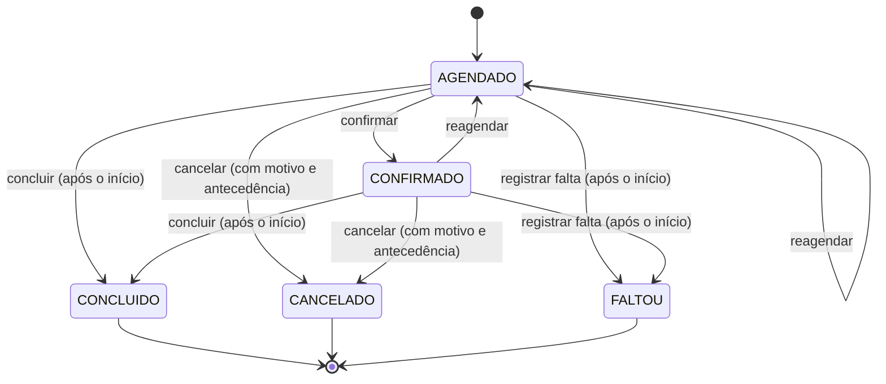
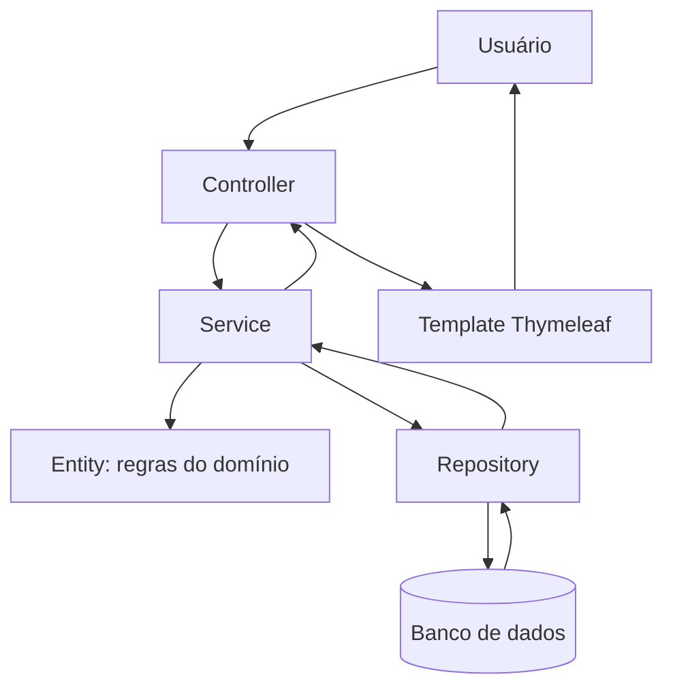
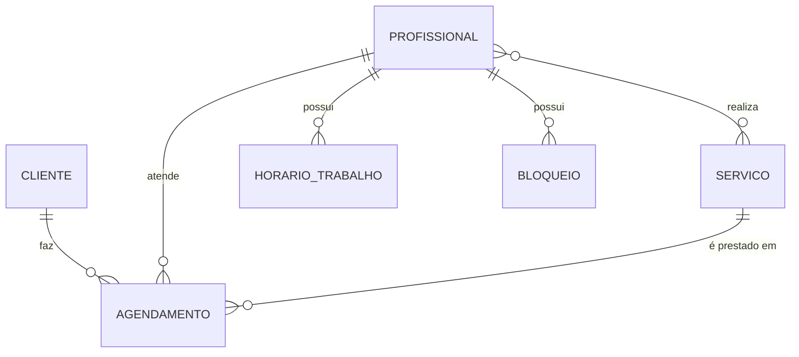

<div align="center">
💜 AgendaFlex
Sistema de Gerenciamento de Agendamentos
Aplicação web para organizar agendamentos, profissionais, clientes e serviços, com regras de disponibilidade, prevenção de conflitos de horário e limites configuráveis.
<p>
  
  
  
  
  
</p>
<p>
  <a href="https://github.com/Joaonascc16/agendaflex/actions/workflows/testes.yml">
    
  </a>
</p>
<p>
  <a href="#-sobre-o-projeto">Sobre</a> •
  <a href="#-funcionalidades">Funcionalidades</a> •
  <a href="#-regras-de-negócio">Regras</a> •
  <a href="#-arquitetura">Arquitetura</a> •
  <a href="#-testes-automatizados">Testes</a> •
  <a href="#-como-executar">Como executar</a>
</p>
</div>
---
📌 Sobre o projeto
O AgendaFlex é um sistema web em Java e Spring Boot para gerenciar o dia a dia de um negócio de atendimento por horário (salão, barbearia, clínica, estúdio). Ele centraliza clientes, profissionais, serviços, jornadas de trabalho e agendamentos.
O foco do projeto está nas regras de negócio: o sistema calcula os horários realmente livres, impede conflitos, respeita folgas e férias, controla cancelamentos e reagendamentos e bloqueia clientes com muitas faltas. Todas as regras ficam no backend (entidades e services), sem depender apenas das validações da interface, e os limites podem ser alterados em `application.properties`.
🚀 Funcionalidades
Módulo	O que faz	Rotas
📊 Painel	Indicadores do dia e da semana, próximos atendimentos e receita	`/`
📅 Agenda	Grade semanal dos atendimentos por profissional	`/agenda`
📝 Agendamentos	Criar (fluxo guiado), listar com filtros, ver detalhes, confirmar, concluir, registrar falta, cancelar com motivo e reagendar	`/agendamentos`, `/agendamentos/novo`, `/agendamentos/{id}`
👥 Clientes	Cadastro, edição, exclusão e zerar faltas	`/clientes`
👨‍💼 Profissionais	Cadastro, edição, exclusão e definição dos serviços que cada um realiza	`/profissionais`
✂️ Serviços	Cadastro com duração e preço, edição e exclusão	`/servicos`
⏰ Disponibilidade	Janelas de trabalho por dia da semana e bloqueios (férias, folgas, consultas)	`/profissionais/{id}/disponibilidade`
O fluxo de novo agendamento segue a ordem serviço → profissional → data → horário livre → cliente. A tela só oferece os profissionais que realizam o serviço escolhido e só mostra horários que passam em todas as regras.
🧠 Regras de negócio
Ao criar ou reagendar
Cliente ativo e sem excesso de faltas.
Serviço e profissional ativos, e o profissional precisa realizar o serviço.
Horário no futuro, respeitando a antecedência mínima e a máxima.
Horário alinhado ao passo da agenda (ex.: de 30 em 30 minutos).
Atendimento inteiro dentro de uma janela de trabalho do profissional, no mesmo dia.
Sem bloqueio (férias, folga...) e sem conflito com outro agendamento do profissional.
Sem conflito com outro agendamento do próprio cliente.
Limite de agendamentos ativos por cliente e de agendamentos por dia (apenas na criação).
Intervalos que apenas se encostam (um termina às 10h e outro começa às 10h) não são considerados conflito.
Ciclo de vida do agendamento

Apenas `AGENDADO` e `CONFIRMADO` ocupam a agenda do profissional.
`CONCLUIDO`, `CANCELADO` e `FALTOU` são estados finais.
Depois de reagendado, o atendimento volta para `AGENDADO` e precisa ser confirmado de novo.
Registrar uma falta soma uma falta ao cliente; ao atingir o limite, ele fica bloqueado para novos agendamentos até que as faltas sejam zeradas.
O preço do serviço é gravado no agendamento (`precoCobrado`), então reajustes futuros não alteram o histórico.
Limites configuráveis
Definidos em `src/main/resources/application.properties`, com o prefixo `agendaflex.regras`:
Propriedade	Padrão	Descrição
`antecedencia-minima-minutos`	120	Antecedência mínima para criar um agendamento
`antecedencia-maxima-dias`	60	Até quantos dias à frente é possível agendar
`antecedencia-minima-cancelamento-minutos`	120	Antecedência mínima para cancelar ou reagendar
`maximo-reagendamentos`	2	Quantas vezes um agendamento pode ser reagendado
`maximo-agendamentos-ativos-por-cliente`	3	Agendamentos ativos futuros por cliente
`maximo-agendamentos-por-cliente-por-dia`	2	Agendamentos de um cliente no mesmo dia
`limite-faltas-para-bloqueio`	3	Faltas que bloqueiam novos agendamentos
`passo-slot-minutos`	30	Intervalo entre horários oferecidos
`hora-inicial-agenda` / `hora-final-agenda`	7 / 21	Janela exibida na agenda semanal
Para mudar uma regra basta editar o valor e reiniciar a aplicação, sem alterar o código.
🛠️ Tecnologias
Tecnologia	Finalidade
Java 17	Linguagem
Spring Boot 3.5.9	Framework (Web MVC, Data JPA, Validation)
Hibernate / Spring Data JPA	Persistência e mapeamento objeto-relacional
Thymeleaf	Páginas renderizadas no servidor
HTML5 e CSS3	Interface (`static/css/agendaflex.css`)
H2 (padrão) e MySQL	Banco em memória para testar rápido e banco real via perfil `mysql`
Lombok	Redução de código repetitivo nas entidades
Maven	Build e dependências
JUnit 5, Mockito e AssertJ	Testes automatizados
GitHub Actions	Integração contínua
🏗️ Arquitetura
O projeto usa arquitetura em camadas. O código principal fica em `agendaflex/` (pasta que contém o `pom.xml`).
```text
agendaflex/                          ← raiz do repositório
├── .github/workflows/testes.yml     ← CI: roda mvn test a cada push/PR
├── README.md
└── agendaflex/                      ← projeto Maven
    ├── pom.xml
    └── src/
        ├── main/
        │   ├── java/br/com/agendaflex/
        │   │   ├── AgendaFlexApplication.java
        │   │   ├── config/          ← regras configuráveis, relógio e dados de demonstração
        │   │   ├── controllers/     ← requisições HTTP e escolha dos templates
        │   │   ├── dtos/            ← dados de entrada, saída e montagem das telas
        │   │   ├── entity/          ← entidades JPA e regras do próprio objeto
        │   │   ├── enums/           ← StatusAgendamento (ciclo de vida)
        │   │   ├── exception/       ← exceções de negócio e tratamento global de erros
        │   │   ├── repository/      ← acesso ao banco (Spring Data JPA)
        │   │   ├── service/         ← regras de negócio e transações
        │   │   └── util/            ← utilitários (tempo e texto)
        │   └── resources/
        │       ├── static/css/      ← estilos
        │       ├── templates/       ← páginas Thymeleaf (+ fragments reutilizáveis)
        │       ├── application.properties
        │       └── application-mysql.properties
        └── test/java/br/com/agendaflex/
            ├── entity/              ← testes das regras das entidades
            ├── service/             ← testes dos services com Mockito
            ├── repository/          ← testes das consultas
            ├── util/
            └── PaginasSmokeTest.java
```
Responsabilidade das camadas
Camada	Classes principais	Responsabilidade
`controllers`	`AgendamentoController`, `ClienteController`, `ProfissionalController`, `ServicoController`, `DisponibilidadeController`, `PainelController`	Receber requisições, chamar o service e devolver a página
`service`	`AgendamentoService`, `PainelService`, `ClienteService`, `ProfissionalService`, `ServicoService`, `HorarioTrabalhoService`, `BloqueioService`	Regras de negócio, cálculo de horários livres e transações
`entity`	`Agendamento`, `Cliente`, `Profissional`, `Servico`, `HorarioTrabalho`, `Bloqueio`	Mapeamento das tabelas e regras de domínio (cancelar, reagendar, sobreposição)
`repository`	`AgendamentoRepository` e demais	Consultas de conflito, contagens, receita e listagens
`dtos`	`AgendamentoDTO`, `AgendamentoResumoDTO`, `SlotDTO`, `PainelDTO`, `AgendaSemanaDTO` e outros	Transportar dados entre tela e service, com validação
`config`	`RegrasAgendamentoProperties`, `RelogioConfig`, `DadosIniciais`	Limites configuráveis, `Clock` injetável e dados de exemplo
`exception`	`RegraNegocioException`, `RecursoNaoEncontradoException`, `GlobalExceptionHandler`	Transformar erros em mensagens claras na tela
Fluxo de uma requisição

Modelo de dados

Decisões de projeto
Regras no domínio: métodos como `cancelar`, `reagendar` e `sobrepoe` ficam na entidade `Agendamento`; o service orquestra e consulta o banco.
Relógio como bean: o `Clock` é injetado, então os testes fixam "a data de hoje" e ficam determinísticos.
Regras configuráveis: limites em `@ConfigurationProperties`, sem números fixos no código.
Histórico de preço: o valor cobrado é copiado para o agendamento no momento da criação.
Menos consultas ao banco: `@EntityGraph` carrega cliente, profissional e serviço juntos nas listagens.
Janelas de trabalho: pausas (como o almoço) são modeladas com duas janelas no mesmo dia (ex.: 08–12 e 13–18).
🧪 Testes automatizados
A suíte usa JUnit 5, Mockito e AssertJ e cobre as camadas do sistema:
Grupo	O que verifica
`entity/`	Regras de cada entidade: sobreposição, cancelamento, reagendamento, transições de status, janelas de trabalho
`service/`	Regras de negócio com dependências simuladas (`AgendamentoService`, `ClienteService`, `HorarioTrabalhoService`)
`repository/`	Consultas de conflito e contagem rodando no banco H2
`util/`	Funções utilitárias de tempo
`PaginasSmokeTest`	Sobe a aplicação inteira com os dados de exemplo e abre cada tela, acusando erros de template
`AgendaFlexApplicationTests`	Verifica se o contexto da aplicação carrega
```bash
mvn test
```
O resultado atualizado de cada execução aparece na aba Actions do GitHub (badge no topo do README).
> Testes aprovados confirmam os cenários cobertos pela suíte, mas não garantem a ausência de defeitos.
💻 Como executar
Pré-requisitos
JDK 17 ou superior
Maven 3.9+ (ou o Maven embutido na sua IDE)
Git
MySQL (opcional, só para o perfil `mysql`)
1. Clonar e entrar na pasta do projeto
```bash
git clone https://github.com/Joaonascc16/agendaflex.git
cd agendaflex/agendaflex
```
O segundo `agendaflex` é a pasta que contém o `pom.xml`.
2. Rodar com H2 (padrão, sem instalar nada)
```bash
mvn spring-boot:run
```
Acesse http://localhost:8080. O banco fica em memória: os dados somem ao encerrar a aplicação. O console do H2 está em `http://localhost:8080/h2` (JDBC URL `jdbc:h2:mem:agendaflex;DB_CLOSE_DELAY=-1`, usuário `sa`, senha vazia).
3. Rodar com MySQL
Confira usuário e senha em `src/main/resources/application-mysql.properties` (o banco `agendaflex` é criado automaticamente) e execute:
```bash
mvn spring-boot:run -Dspring-boot.run.profiles=mysql
```
> Os dados de exemplo continuam ligados por padrão. Para usar o MySQL só com seus dados reais, adicione `-Dspring-boot.run.arguments="--agendaflex.dados-demo=false"`.
>
> Não publique senhas reais no repositório; prefira variáveis de ambiente.
4. Executar os testes
```bash
mvn test
```
Dados de demonstração
Com `agendaflex.dados-demo=true` (padrão), a primeira execução carrega:
Serviços: Corte de cabelo (45 min), Barba (30 min), Coloração (120 min) e Massagem relaxante (60 min).
Profissionais: Ana Souza (cabeleireira), Bruno Lima (barbeiro) e Carla Mendes (massoterapeuta), com expediente de segunda a sexta (08–12 e 13–18) e sábado pela manhã.
Clientes e agendamentos em vários status, uma folga cadastrada e um cliente bloqueado por faltas, para você ver as regras funcionando logo de início.
⚙️ Integração contínua
O workflow `.github/workflows/testes.yml` (nome Build e testes) roda `mvn test` com Java 17 a cada push ou pull request na branch `master`, e também pode ser disparado manualmente.
🔭 Próximos passos
Controle de concorrência (lock ou `@Version`) para evitar dois agendamentos simultâneos no mesmo horário.
Autenticação e perfis de acesso com Spring Security.
Paginação nas listagens.
Migrações de banco com Flyway.
Relatório de cobertura de testes (JaCoCo).
<!-- Dica: adicione capturas de tela em docs/img/ e exiba aqui (painel, agenda semanal, novo agendamento). -->
👨‍💻 Autor
João Pedro do Nascimento Morais
Técnico em Desenvolvimento de Sistemas (SENAI/SC), com interesse em Java, desenvolvimento backend e aplicações web.
GitHub: @Joaonascc16
LinkedIn: joaopedro-morais
---
<div align="center">
Desenvolvido com 💜 utilizando Java e Spring Boot.
AgendaFlex © 2026
</div>
