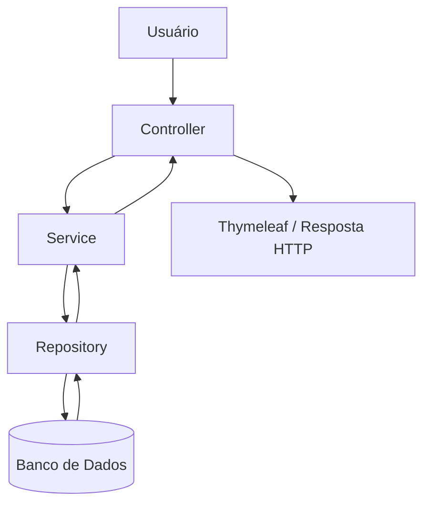

 <div align="center">

# 💜 AgendaFlex

### Sistema de Gerenciamento de Agendamentos

Uma aplicação web desenvolvida para organizar agendamentos, gerenciar profissionais, clientes e serviços, com validações de disponibilidade e prevenção de conflitos de horários.

<p>
  
  
  
  
</p>

<p>
  <a href="https://github.com/Joaonascc16/agendaflex">Repositório</a> •
  <a href="#-funcionalidades">Funcionalidades</a> •
  <a href="#-instalação">Instalação</a> •
  <a href="#-testes">Testes</a>
</p>

</div>

---

## 📌 Sobre o projeto

O **AgendaFlex** é um sistema web desenvolvido com Java e Spring Boot para facilitar o gerenciamento de agendamentos e a organização de atendimentos.

A aplicação centraliza informações de clientes, profissionais, serviços e horários, oferecendo recursos para administrar a agenda e controlar a disponibilidade dos profissionais.

O projeto foi desenvolvido com foco na aplicação prática de conceitos de desenvolvimento backend, arquitetura em camadas, persistência de dados e testes automatizados.

## 🚀 Funcionalidades

| Módulo | Funcionalidades |
|---|---|
| 📊 Painel | Visualização geral das informações da agenda |
| 📅 Agenda | Visualização dos agendamentos da semana |
| 📝 Agendamentos | Criação, consulta, reagendamento e cancelamento |
| 👥 Clientes | Cadastro, consulta e edição de clientes |
| 👨‍💼 Profissionais | Gerenciamento de profissionais |
| ✂️ Serviços | Cadastro e gerenciamento de serviços |
| ⏰ Disponibilidade | Controle de horários de trabalho e bloqueios |

## 🧠 Regras de negócio

O AgendaFlex possui validações para garantir a consistência das operações e evitar conflitos na agenda.

**Principais regras implementadas:**

- **Disponibilidade profissional:** apresentação de horários conforme a disponibilidade do profissional.
- **Prevenção de conflitos:** impedimento de agendamentos sobrepostos para o mesmo profissional.
- **Duração dos serviços:** consideração do horário inicial e final do atendimento.
- **Horário de trabalho:** respeito aos períodos de atendimento cadastrados.
- **Bloqueios de agenda:** impedimento de agendamentos em períodos bloqueados.
- **Reagendamento:** nova validação de disponibilidade ao alterar um agendamento.
- **Cancelamento:** possibilidade de registrar o motivo do cancelamento.
- **Validação cadastral:** verificação dos dados obrigatórios nas operações de cadastro.

As regras de negócio são tratadas principalmente na camada de serviços, evitando que a aplicação dependa exclusivamente das validações da interface.

## 🛠️ Tecnologias utilizadas

| Tecnologia | Finalidade |
|---|---|
| Java 17 | Linguagem de programação |
| Spring Boot 3.5.9 | Framework backend |
| Spring MVC | Controle das requisições HTTP |
| Spring Data JPA | Persistência de dados |
| Hibernate | Mapeamento objeto-relacional |
| MySQL | Banco de dados |
| Thymeleaf | Renderização das páginas |
| HTML5 e CSS3 | Interface web |
| Maven | Gerenciamento de dependências |
| JUnit 5 | Testes automatizados |
| Mockito | Simulação de dependências |
| Git e GitHub | Versionamento |
| GitHub Actions | Integração contínua |

## 🏗️ Arquitetura do projeto

O projeto utiliza uma arquitetura em camadas, separando as responsabilidades para facilitar a manutenção, organização e evolução do código.

### Estrutura de diretórios

```text
src/
├── main/
│   ├── java/
│   │   └── .../
│   │       ├── controller/
│   │       ├── dto/
│   │       ├── entity/
│   │       ├── repository/
│   │       └── service/
│   │
│   └── resources/
│       ├── static/
│       │   └── css/
│       ├── templates/
│       └── application.properties
│
└── test/
    └── java/
        └── .../
            └── service/
```

### Responsabilidade das camadas

| Camada | Responsabilidade |
|---|---|
| Controller | Recebimento e tratamento das requisições HTTP |
| DTO | Transferência e organização de dados |
| Entity | Representação das entidades do banco de dados |
| Repository | Comunicação com o banco de dados |
| Service | Implementação e validação das regras de negócio |

### Fluxo de execução



## 🧪 Testes automatizados

O projeto possui uma suíte de testes automatizados utilizando JUnit 5 e Mockito.

Os testes verificam o comportamento dos serviços, a execução das regras de negócio e o tratamento de diferentes cenários.

### Resultados da última execução validada

<div align="center">

| Indicador | Resultado |
|:---:|:---:|
| Testes executados | **127** |
| Falhas | **0** |
| Erros | **0** |
| Ignorados | **0** |
| Resultado | **BUILD SUCCESS** |

</div>

<p align="center">
  
</p>

A execução dos testes também está integrada ao GitHub Actions, permitindo automatizar a validação do projeto durante as atualizações do repositório.

> A aprovação dos testes confirma os cenários cobertos pela suíte automatizada, mas não representa uma garantia de ausência de defeitos.

## 💻 Instalação

### Pré-requisitos

Antes de executar o projeto, tenha instalado:

- JDK 17 ou compatível com a configuração do projeto.
- Maven.
- MySQL.
- IntelliJ IDEA ou outra IDE compatível com Java.
- Git.

### 1. Clone o repositório

```bash
git clone https://github.com/Joaonascc16/agendaflex.git
```

### 2. Acesse a pasta do projeto

```bash
cd agendaflex
```

Entre na pasta que contém o arquivo `pom.xml`, caso o projeto esteja em um diretório interno.

### 3. Configure o banco de dados

Abra o arquivo:

```text
src/main/resources/application.properties
```

Configure as propriedades de conexão com o MySQL de acordo com o seu ambiente.

Não publique senhas ou credenciais reais no repositório.

### 4. Execute os testes

```bash
mvn test
```

### 5. Inicie a aplicação

```bash
mvn spring-boot:run
```

Também é possível iniciar a aplicação executando a classe principal diretamente pela IDE.

## 🌐 Acesso ao sistema

Após iniciar a aplicação, acesse:

```text
http://localhost:8080
```

## ⚙️ Integração contínua

O projeto utiliza GitHub Actions para automatizar a execução dos testes.

Workflow:

```text
.github/workflows/testes.yml
```

A automação permite verificar se as alterações enviadas ao repositório continuam passando pela suíte de testes.

<p align="center">
  <a href="https://github.com/Joaonascc16/agendaflex/actions">
    
  </a>
</p>

## 📷 Interface do sistema

<!-- Adicione aqui capturas de tela reais do AgendaFlex. -->

As imagens podem ser adicionadas posteriormente para demonstrar o painel, a agenda semanal, os cadastros e a tela de agendamento.

## 📁 Repositório

<div align="center">

**AgendaFlex — Gerenciamento de agendamentos**

<a href="https://github.com/Joaonascc16/agendaflex">
  
</a>

</div>

## 👨‍💻 Autor

**João Pedro do Nascimento Morais**

Desenvolvedor em formação, com interesse em Java, desenvolvimento backend e construção de aplicações web.

- GitHub: [@Joaonascc16](https://github.com/Joaonascc16)

---

<div align="center">

Desenvolvido com 💜 utilizando Java e Spring Boot.

**AgendaFlex © 2026**

</div>
